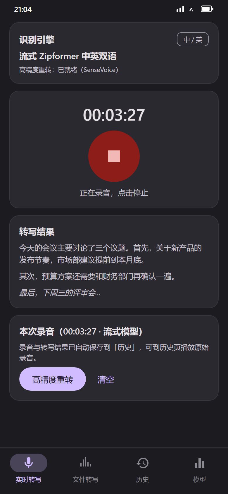
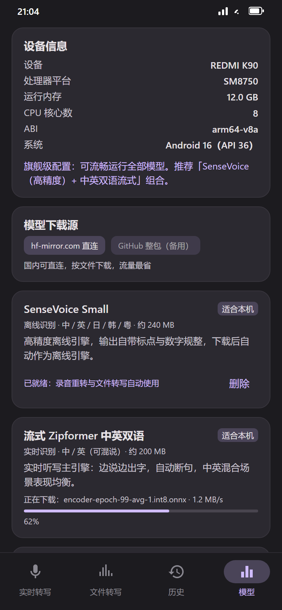
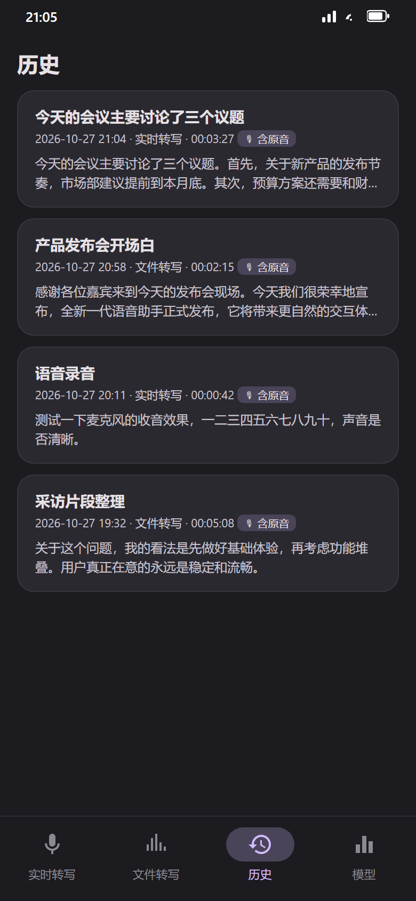
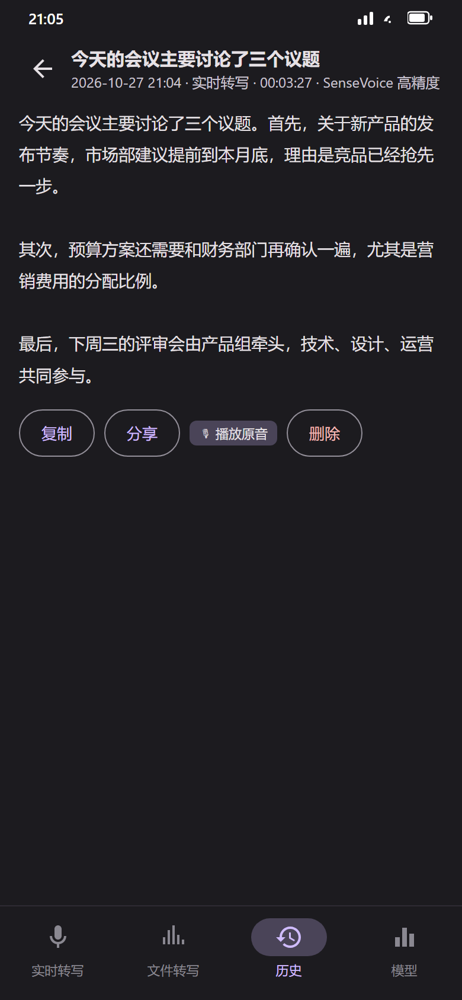
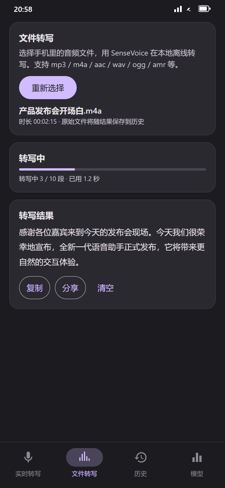

# WaveScribe — 完全免费的手机离线语音转录

> 🎙️ 手机本地离线语音转文字 · 完全免费 · 无广告 · 无订阅 · 无账号 · 无需联网 · 隐私无忧

WaveScribe 是一款运行在安卓手机上的**离线语音转录（ASR）App**：
录音和转写全部在手机本地完成，音频和文字**都不会上传到任何服务器**。
打开就能用，模型从 App 内免费下载，一次下载永久离线。

## ✨ 功能

| 功能 | 说明 |
|---|---|
| 🎤 实时转写 | 流式识别，边说边出字，端点自动断句，中英双语可混说 |
| 📼 原始录音自动保存 | 每次实时转录结束，录音（WAV）与文字一起自动存入「历史」，可随时播放原音 |
| ✍️ 高精度重转 | 录音停止后用 SenseVoice 一键重转，输出带标点、自动数字规整 |
| 📂 文件转写 | 选择 mp3 / m4a / aac / wav / ogg / amr 等音频文件离线转写，原始文件一并归档 |
| 🤖 模型按配置推荐 | 自动读取设备内存/CPU/架构，为你的手机推荐"适合本机"的模型 |
| ⬇️ 应用内免费下载模型 | hf-mirror 直连（国内免梯子）/ GitHub 整包双下载源，支持断点续传 |
| 📚 历史记录 | 转写结果自动保存，支持复制、分享、播放原音 |
| 🔒 完全离线 | 识别、解码、转写全部在本地，无网络权限也照常工作（仅模型下载需要网络） |

## 📸 界面预览

<table>
<tr>
<td align="center"><br/><sub>实时转写</sub></td>
<td align="center"><br/><sub>模型管理（按设备推荐）</sub></td>
<td align="center"><br/><sub>历史记录（含原音）</sub></td>
<td align="center"><br/><sub>历史详情（播放原音）</sub></td>
<td align="center"><br/><sub>文件转写</sub></td>
</tr>
</table>

## 📱 完全免费

- **无内购、无订阅、无广告、无账号注册**
- 不收集任何个人信息，不发送任何统计数据
- 模型全部来自开源社区（sherpa-onnx / SenseVoice / Zipformer），永久免费

## ⬇️ 安装

1. 从 [Releases](../../releases) 下载最新的 `WaveScribe-vX.X.X.apk`
2. 传到手机，允许「安装未知应用」后安装
3. 首次打开进入「模型」页，下载推荐模型：
   - **流式 Zipformer 中英双语**（实时听写，约 200 MB）
   - **SenseVoice Small**（高精度离线，约 240 MB）
4. 回到「实时转写」页，点麦克风开始听写

> 提示：模型下载走 hf-mirror.com 国内直连，断点续传；网络不佳可切换到 GitHub 整包源。

## 🧠 内置模型

| 模型 | 类型 | 语言 | 体积 | 说明 |
|---|---|---|---|---|
| SenseVoice Small | 离线 | 中/英/日/韩/粤 | ~240 MB | 高精度，带标点与数字规整 |
| 流式 Zipformer 中英双语 | 实时 | 中/英 | ~200 MB | 实时听写主力，支持混说 |
| 流式 Zipformer 中文增强 | 实时 | 中文 | ~170 MB | 2025 新版，纯中文更准 |
| 流式 Zipformer 轻量中文 | 实时 | 中文 | ~25 MB | 低内存设备兜底 |

## 🔨 从源码构建

```bash
# 环境：JDK 17 + Android SDK（compileSdk 35）
git clone https://github.com/Confusedisprecious/WaveScribe.git
cd WaveScribe
./gradlew assembleRelease
# 输出：app/build/outputs/apk/release/app-release.apk
```

> 说明：sherpa-onnx 官方安卓 AAR（`app/libs/sherpa-onnx-2.0.0.aar`）已随仓库提供，clone 后可直接构建，无需额外下载。

## 📁 项目结构

```
app/src/main/java/com/zanzan/voicetranscribe/
├── asr/      模型目录、引擎管理、流式/离线转写
├── audio/    音频解码（MediaCodec）、WAV 工具
├── download/ 模型下载器（断点续传 + tar.bz2 解压）
├── data/     历史记录存储
├── device/   设备信息与模型推荐
└── ui/       Jetpack Compose 界面（转写 / 文件 / 历史 / 模型）
```

## 📄 许可

- 本项目代码：MIT
- [sherpa-onnx](https://github.com/k2-fsa/sherpa-onnx)（Apache-2.0），随仓库提供官方安卓 AAR
- 模型：SenseVoice（Apache-2.0）、Zipformer（Apache-2.0）

## 🙏 致谢

- [sherpa-onnx](https://github.com/k2-fsa/sherpa-onnx) — 全平台端侧语音推理框架
- [FunAudioLLM / SenseVoice](https://github.com/FunAudioLLM/SenseVoice) — 高精度多语言识别模型
- k2-fsa 社区 — 流式 Zipformer 模型与评测基准